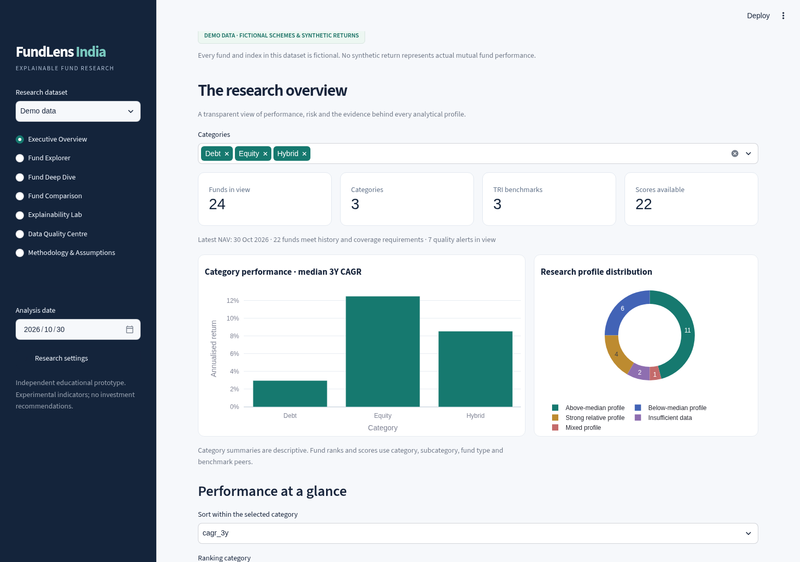
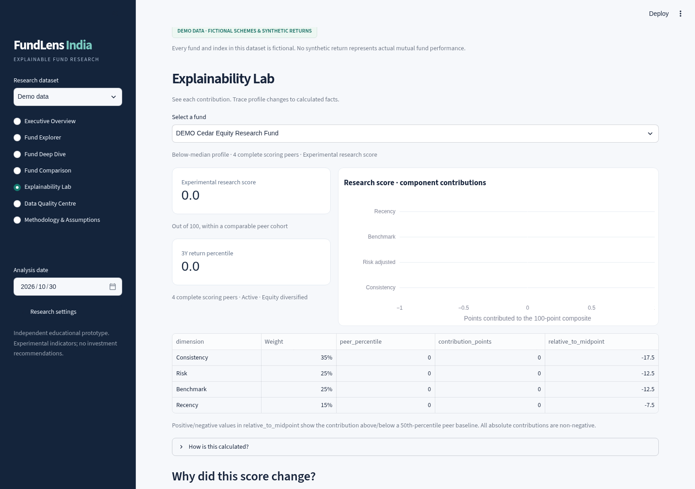
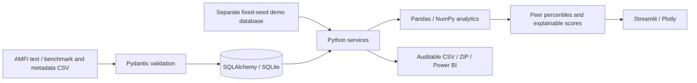

# FundLens India
### Explainable Mutual Fund Intelligence Platform

An independent educational research application that turns NAV histories into visible,
reproducible evidence: calendar returns, rolling outcomes, risk, benchmark-relative performance,
comparable peers and an experimental score with a full contribution breakdown.

**Every first-launch fund and benchmark is fictional, fixed-seed DEMO DATA.** Switch to a
separate uploaded dataset for real, traceable NAV/metadata/TRI files. No synthetic performance
is presented as actual mutual fund history.



## Why it exists

Historical returns are easy to display and difficult to interpret. Strong returns may coexist
with high volatility, poor consistency, deep drawdowns or inadequate data. FundLens exposes
the data, formulas, peer group and limitations behind an analytical profile so research can
be inspected, questioned and reproduced. It demonstrates Python, SQL, financial analytics,
BI and product engineering in one runnable portfolio project.

## Product capabilities

| Workspace | Working capability |
|---|---|
| Executive Overview | Category filters, coverage/availability counts, median performance and profile distribution |
| Fund Explorer | Search, AMC/category/subcategory/type/benchmark/history filters, sortable table and CSV export |
| Fund Deep Dive | NAV, growth of 100, rolling distributions/excess returns, drawdown, volatility, peers and report download |
| Fund Comparison | Up to four funds, common observation dates and cross-category context warning |
| Explainability Lab | Peer percentiles, weighted contributions, historical recalculation, change waterfall and saved snapshots |
| Data Quality Centre | Manual AMFI/benchmark/metadata imports, 90-day request planner, conflicts, validation, audit and BI exports |
| Methodology & Assumptions | Formulas, weights, annualisation, provenance, missing-data policy and limitations |



## Quick start

Python **3.11+**. Run from the repository root:

```bash
git clone https://github.com/abhinavgautam121/FundLens-India.git
cd FundLens-India
python -m venv .venv
source .venv/bin/activate
pip install -r requirements.txt
cp .env.example .env
streamlit run app.py
```

Open http://localhost:8501. Database tables and the deterministic synthetic dataset initialise
automatically. No private APIs, secret keys or LLM calls are required. On Windows activate
with `.venv\Scripts\activate` and copy `.env.example` using your shell.

## Architecture and stack



Python, Pandas, NumPy, SQLAlchemy, Pydantic, Streamlit, Plotly, YAML, dotenv, Pytest and Ruff.
The initial schema has schemes, NAV history, benchmark definitions/history, calculated metrics,
research snapshots and import logs. Unique observation keys, foreign keys and date/peer indexes
support idempotent ingestion and analysis. Full schema: [database/schema.sql](database/schema.sql).
Architecture, data-flow and ER diagrams: [docs/ARCHITECTURE.md](docs/ARCHITECTURE.md).

## Data and imports

1. Choose **Uploaded data → Data Quality Centre**. The uploaded dataset starts empty.
2. Import benchmark CSV: `date,benchmark_code,benchmark_name,tri_value`. Explicitly mark TRI
   only after verifying total-return status. Price/unverified indices are excluded from scoring.
3. Import scheme metadata using the downloadable CSV template. Include classification,
   benchmark mapping, inception/source/as-of dates; leave unavailable expense ratio/AUM blank.
4. Download official [AMFI NAV text files](https://www.amfiindia.com/net-asset-value/nav-download)
   and import them with a traceable source. The historical planner splits ranges into ≤90-day
   requests. A single recent file is not sufficient history for long-horizon metrics.
5. Review accepted/rejected/duplicate counts and downloadable errors. Conflicting NAV or
   benchmark duplicates preserve the stored observation. NAV-only import works, with scores
   withheld until required history, metadata, benchmarks and peers are available.

Manual imports work without automatic scraping. Files are limited to 20 MB; larger datasets
can be split. Real data is not bundled, and provider accuracy/TRI status requires verification.
Full workflow: [USER_GUIDE.md](docs/USER_GUIDE.md).

## Analytical methodology

- Calendar returns: 1M/3M/6M/1Y total returns; 3Y/5Y CAGR using actual days and 365.25.
- Rolling 1Y/3Y/5Y returns: best/worst/median/quartiles, distribution and benchmark win rate.
- Risk: 252-day volatility, running-peak maximum drawdown, downside deviation, Sharpe/Sortino
  with an explicit configurable annual risk-free assumption (initially 6%, not a live quote).
- Benchmarks: exact date alignment, TRI-only relative analysis, excess CAGR, tracking difference
  (difference of aligned CAGRs), and annualised standard deviation of daily return differences.
- Peers: category + subcategory + Active/Passive + benchmark, same analysis date; at least
  three eligible comparable funds. Average-rank percentiles preserve ties.
- Score: normalised consistency, Sortino, benchmark and recency inputs × documented category
  weights. Passive benchmark input is negative tracking error. Lower volatility is not assumed
  universally better. Missing important inputs withhold the entire composite.
- Historical results exclude future observations and future-dated classification metadata.
  Versioned snapshots retain full parameter JSON. Deterministic explanations describe measured
  changes without inventing market causes.

The weights and neutral profile thresholds are illustrative educational choices, not a
validated investment model. [METHODOLOGY.md](docs/METHODOLOGY.md) documents every formula,
window, eligibility rule, missing-data policy and point-in-time limitation.

## Tests, quality and reproducibility

```bash
pytest -q
ruff check .
python -m scripts.export_demo
```

Tests include hand-calculated returns/risk examples, calendar rolling windows, benchmark
alignment/tracking, score arithmetic/missing inputs, duplicates, invalid uploads, end-to-end
imports, no-look-ahead checks, SQL/exports, and all seven Streamlit routes.
See [VALIDATION.md](docs/VALIDATION.md) for actual results and browser verification.
GitHub Actions runs tests and lint on Python 3.11 and 3.12. `requirements-lock.txt` records the
exact locally tested Python 3.12 dependency set; compatible Python 3.11 versions resolve from
`requirements.txt`.

## Power BI and SQL

`python -m scripts.export_demo` produces nine CSV dimension/fact tables and a ZIP manifest in
`powerbi/exports/`, plus a [sample analytical report](docs/SAMPLE_REPORT.md). The app also
exports uploaded-data analytics and Power BI tables through its quality centre.

See [POWER_BI_GUIDE.md](powerbi/POWER_BI_GUIDE.md) for the star/snowflake model, grain, data types,
relationships, DAX and dashboard specification. [SQL queries](sql/business_queries.sql) answer
category rolling-return medians, volatility extremes, benchmark consistency, drawdowns and
historical percentile improvements. A `.pbix` file is not fabricated.

## Deploy and demonstrate

Streamlit Community Cloud and a non-root Dockerfile are prepared. Exact commands, persistence
and environment details: [DEPLOYMENT.md](docs/DEPLOYMENT.md). Local validation does not claim
a production deployment. Community Cloud SQLite storage is ephemeral.

- [4-minute product demonstration script](docs/DEMO_SCRIPT.md)
- [One-page business case](docs/BUSINESS_CASE.md)
- [Data dictionary](docs/DATA_DICTIONARY.md)
- [Actual app screenshots](docs/screenshots/)
- [Original project specification](docs/PROJECT_SPECIFICATION.md)

## Known limitations and next iteration

Weekday coverage approximates trading days and does not include an Indian holiday calendar.
Small peer cohorts, overlapping rolling windows, classification quality and selection bias
limit inference. Metadata has one current record, so older as-of classification is unavailable
after certain updates; late historical imports may revise a past analysis. This is not a
bitemporal “what was known at import time” research database.

SQLite and instance-wide uploads suit a local/internal educational prototype. Authentication,
per-user datasets, official market calendars, revised metadata history, larger validated cohorts,
independent source reconciliation, PostgreSQL runtime verification and production monitoring
are sensible next steps. Expense ratio and AUM remain unavailable when not supplied. NAV
metrics do not model investor-specific cash flows, taxes, entry/exit loads or future returns.

## Disclaimer

FundLens India is an independent educational mutual fund analytics prototype. It is not
affiliated with or endorsed by PowerUp Money, AMFI, SEBI or any asset management company.
Its analytical scores are experimental research indicators and do not constitute investment
advice or recommendations. Past performance does not guarantee future results. Verify all
data and consult a qualified, appropriately registered professional before making investment
decisions.
