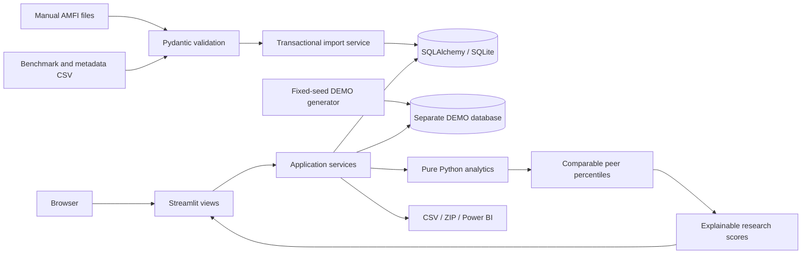
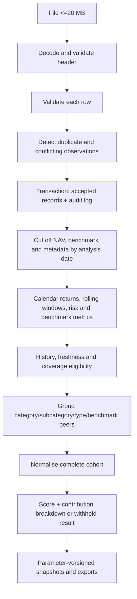
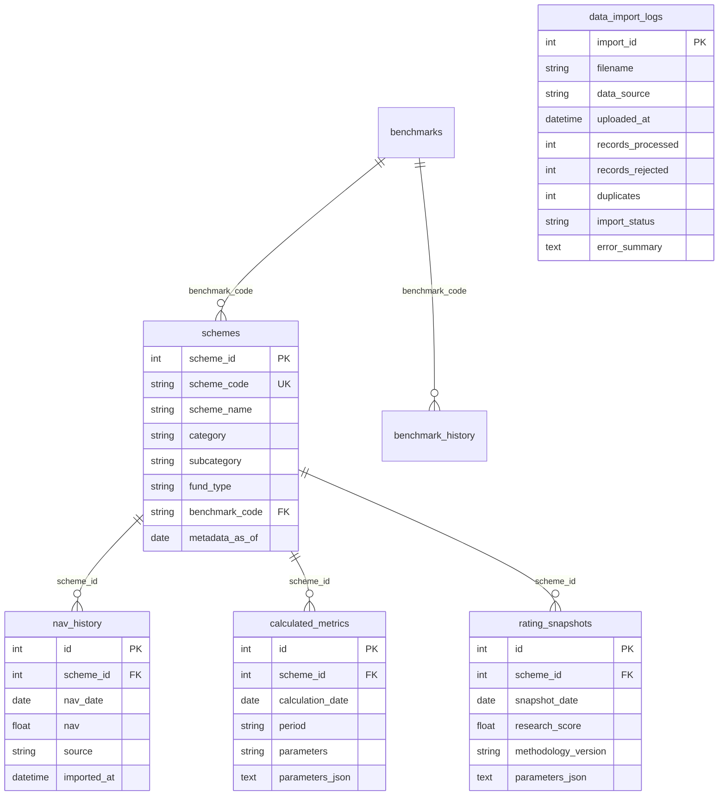

# Architecture

The app runs as one Python process with an embedded SQLite database. Streamlit renders views;
reusable analytics functions contain the formulas; services orchestrate validated ingestion,
point-in-time computation, persistence and exports. No LLM or private API is required.

## Data flow

## Database ER diagram

`database/schema.sql` is generated from SQLAlchemy metadata and includes the complete fields,
indexes and uniqueness constraints. Foreign keys are enabled for SQLite. Observation imports
do not overwrite conflicts. Data-import audit is file-grained with sanitised row error messages;
it does not retain raw uploaded payloads or personal financial details.

## Runtime and deployment boundaries

- Streamlit uses its native widget/websocket protocol. No separate API server is introduced.
- The demo and uploaded databases must have different URLs. No synthetic fallback contaminates
  uploaded-data analytics. Uploaded data starts empty and remains clearly labelled.
- SQLite is intended for a single-instance educational deployment. Multi-user/public uploads
  share that instance's dataset; this is not a private per-user storage product. Use access
  controls at the deployment host for an internal research workspace.
- SQLAlchemy is portable to PostgreSQL; install an appropriate driver, set `DATABASE_URL`,
  and validate deployment-specific concurrency/backups. PostgreSQL operation is prepared,
  but is not part of the locally verified SQLite runtime.
- Initial schema creation is automatic. See `database/migrations/README.md` for future upgrades.
- Streamlit Community Cloud requires only the repository and Python dependencies. Sites'
  Cloudflare Worker runtime does not host this Python/Streamlit application.
