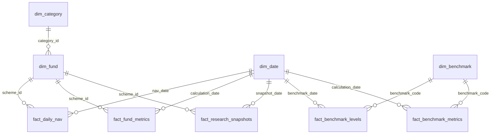

# FundLens India — Power BI guide

The sample dataset is **DEMO DATA**: fictional schemes, synthetic NAVs and synthetic TRI
benchmarks. It must not be presented as historical Indian mutual fund performance.

## Generate the files

Run from the repository root after installing requirements:

```bash
python -m scripts.export_demo
```

The command creates nine CSV tables and `fundlens-demo-powerbi.zip` in `powerbi/exports/`.
It also generates `docs/SAMPLE_REPORT.md` using the same analytics engine as the application.
For uploaded data, open **Data Quality Centre → Exports & Power BI → Download Power BI dataset**.
That export is limited to the selected analysis date; the manifest states dataset type and date.

## Recommended star schema



Category → fund is a small snowflake extension to the fact-table stars. Use one-to-many,
single-direction dimension-to-fact filters. Avoid connecting fact tables directly. A fund's
benchmark code is descriptive; an additional active relationship to dim_benchmark may create
ambiguous filter paths and should remain inactive if already connected through other dimensions.

| File | Grain |
|---|---|
| dim_fund | One current metadata row per scheme |
| dim_category | One category/subcategory pair |
| dim_date | One calendar day (includes weekends) |
| dim_benchmark | One index definition with TRI/Price/Unverified type |
| fact_daily_nav | One scheme/date NAV with source and import timestamp |
| fact_fund_metrics | Scheme/analysis date/3Y horizon/parameter version |
| fact_benchmark_levels | One benchmark/date index level with source |
| fact_benchmark_metrics | Benchmark/analysis date/3Y horizon CAGR, volatility, drawdown |
| fact_research_snapshots | Scheme/snapshot date/methodology parameter version |

## Import and types

1. Unzip the export. In Power BI Desktop, choose **Get Data → Text/CSV** for each file.
2. In Power Query, set IDs to whole numbers (scheme_code and benchmark_code remain text);
   dates to Date; NAV/index values/metrics to decimal; provenance fields to Text.
3. Select `dim_date[date]` as the date-table key. Create relationships shown above.
4. Set decimal return, volatility, coverage and win-rate columns to percentage format.
   Research score and category percentile are already on a 0–100 scale. Do not multiply them
   by 100. Negative drawdown is a decimal percentage; Sharpe/Sortino are unitless.
5. Filter to **one calculation_date and one parameters/methodology_version** before showing
   metrics or research scores. The `parameters_json` columns retain the actual weights,
   annual risk-free assumption and methodology settings. Never mix parameter versions.
6. Add a visible dataset label and the disclaimer on every report page. Retain nulls as
   unavailable; do not replace them with zero or average them as if they were observed.

## Executive report specification

- **Executive overview**: fund/category counts, last NAV date, rated/unrated count;
  category median 3Y CAGR; profile distribution; coverage table.
- **Performance and risk**: scatter 3Y CAGR vs annualised volatility; rolling median return;
  negative maximum drawdown; category/subcategory/fund-type/benchmark slicers.
- **Benchmark research**: excess CAGR, rolling win rate and active/passive selection.
  For passive funds, tracking error and tracking difference are the primary diagnostics.
- **Explainability**: weighted contribution bars; total composite; parameter version;
  snapshot changes restricted to the same parameter version. Contributions in snapshots
  store points, not raw component percentiles.
- **Quality and lineage**: weekday coverage, withheld scores, source, imported_at and
  metadata_as_of. Import audit and row-level validation reports are separate app downloads.

Suggested DAX (after applying the date/version filters):

```dax
Funds = DISTINCTCOUNT(dim_fund[scheme_id])
Median 3Y CAGR = MEDIAN(fact_fund_metrics[cagr])
Scored Funds = COUNT(fact_research_snapshots[research_score])
Mean Coverage = AVERAGE(fact_fund_metrics[data_coverage])
Median Rolling Return = MEDIAN(fact_fund_metrics[rolling_median])
```

These category summaries are descriptive. Comparable research peers also require subcategory,
fund type and benchmark equality; cross-category scatter points do not form a single ranking.
No `.pbix` is fabricated: build the report in licensed Power BI Desktop from these actual files.
SQL versions of the business questions are in `sql/business_queries.sql`.
